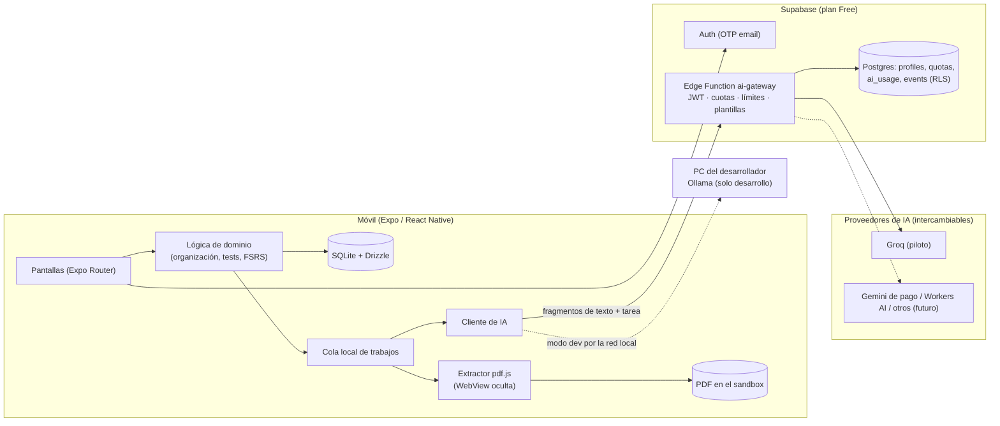
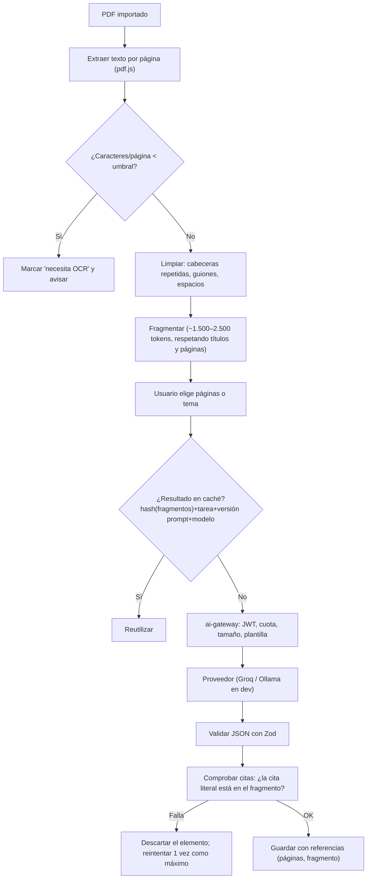

# Classence — Plan inicial (v0.2, propuesta pendiente de aprobación)

> Fecha: 20/10/2026 · Estado: **BORRADOR — no aprobado** · Autor: planificación asistida por Claude
>
> **Cambios v0.2:** hardware confirmado (PC de sobremesa: i5 13.ª–15.ª gen, 16 GB RAM, RTX 4060 8 GB);
> **código en el portátil** con **emulador Android** (sin móvil físico de momento); **Ollama en el PC de
> sobremesa** solo cuando toque la IA (el spike pasa de S1 a S2); **repositorio público**; el
> calendario de exámenes no condiciona los sprints.
>
> Este documento reúne la primera respuesta de planificación pedida en el prompt maestro (13 apartados).
> Cuando se apruebe, en el Sprint 1 se repartirá en `docs/PRODUCT_VISION.md`, `docs/MVP_SCOPE.md`,
> `docs/ROADMAP.md`, `docs/PRODUCT_BACKLOG.md`, `docs/ARCHITECTURE.md`, `docs/DATA_MODEL.md`,
> `docs/AI_STRATEGY.md`, `docs/SECURITY.md`, `docs/TESTING.md` y `docs/DECISIONS/`.

## Estado real del repositorio

`C:\PROYECTOS\Classence` está **vacía**: no hay archivos ni repositorio Git. No hay nada que conservar
ni migrar. La estructura propuesta está en el apartado 7.

Datos verificados en fuentes oficiales el 20/10/2026 (los precios y límites cambian, así que hay que
volver a comprobarlos antes de cada decisión que dependa de ellos):

| Dato | Valor verificado | Fuente |
|---|---|---|
| Expo SDK actual | SDK 57 (30/06/2026), React Native 0.86, React 19.2 | expo.dev/changelog/sdk-57 |
| EAS plan gratuito | 15 builds Android + 15 iOS (cola de baja prioridad), EAS Update 1.000 MAU, sin cargos por exceso | expo.dev/pricing |
| Supabase Free | BD 500 MB, almacenamiento 1 GB, 50 MB por archivo, 5 GB de transferencia de salida, 50.000 MAU, 500.000 invocaciones de Edge Functions, 2 proyectos, **pausa tras 1 semana de inactividad**, **sin copias de seguridad** | supabase.com/pricing |
| Supabase Edge Functions (Free) | 256 MB RAM, **2 s de CPU por petición**, 150 s de duración máxima | supabase.com/docs/guides/functions/limits |
| Gemini API, nivel gratuito | Hay modelos Flash/Flash‑Lite gratuitos, pero **el contenido se usa para mejorar productos de Google (con revisión humana)**, **no se puede usar el nivel gratuito para dar servicio a usuarios del EEE, Reino Unido o Suiza** y exige **18+** | ai.google.dev/gemini-api/docs/pricing y /terms |
| Groq, plan gratuito | p. ej. `openai/gpt-oss-120b` y `qwen/qwen3.8-27b`: 30 peticiones/min, 1.000/día, **8.000 tokens/min**, **200.000 tokens/día** (por organización, no por usuario) | console.groq.com/docs/rate-limits |
| Groq, datos | No entrena con entradas/salidas sin permiso expreso; no retiene datos de inferencia por defecto (hasta 30 días por abuso/errores), opción de retención cero; almacenamiento en EE. UU.; exige **18+**; prohíbe usarlo «para evitar pagar» | console.groq.com/docs/your-data y services-agreement |
| Cloudflare Workers AI | 10.000 «neurons»/día gratis (≈390.000 tokens de entrada o ≈133.000 de salida con Llama 3.1 8B) | developers.cloudflare.com/workers-ai/platform/pricing |
| Mistral (modo gratuito) | Por defecto **puede entrenar** con entradas y salidas (se puede desactivar) | help.mistral.ai |
| Sentry Developer | 5.000 errores, 1 usuario, 30 días de historial | sentry.io/pricing |
| Google Play, cuentas personales nuevas | Prueba cerrada con **≥12 testers durante 14 días seguidos** antes de publicar en producción | support.google.com/googleplay/android-developer/answer/14151465 |
| FSRS | Librería `ts-fsrs` (v5.x, MIT) | npmjs.com/package/ts-fsrs |

---

## 1. Resumen ejecutivo

**Qué:** una app móvil (Android primero) que convierte los PDF de una asignatura en un **ciclo de
estudio cerrado**: resumen fundamentado → test → corrección explicada → tarjetas a partir de los
fallos → repaso espaciado. Cada pieza generada se apoya en una cita del documento.

**Para quién (usuario inicial):** estudiantes universitarios españoles **mayores de 18 años**, en
carreras con mucho temario en PDF (Derecho, ADE, Ciencias de la Salud, Ingeniería teórica), que
preparan exámenes parciales y finales desde el móvil. Lo de mayores de 18 no es solo un nicho: los
proveedores de IA viables (Groq, Gemini) exigen 18+, y así evitamos el régimen de menores del RGPD
en el MVP.

**Propuesta de valor:** «Sube los apuntes de tu asignatura y Classence te dice qué dominas y qué no,
con preguntas que salen de *tu* temario y te señalan la página exacta».

**Principios de arquitectura:** *local-first* (documentos y progreso en el teléfono), una pasarela de
IA mínima en el servidor que guarda las claves y controla las cuotas, y proveedores de IA
intercambiables.

**Calendario realista:** unos 14 sprints de una semana (~7 h comprometidas + ~2 h de margen) hasta un
**piloto cerrado con 10–15 estudiantes** (≈ finales de enero / febrero de 2027). Con presupuesto cero
la capacidad de IA gratuita aguanta un piloto, **no un lanzamiento público** (ver apartado 5).

---

## 2. Evaluación crítica

### Fortalezas
- El problema es real y frecuente (temario disperso, poco tiempo, no saber qué se domina).
- El ciclo «fallo → tarjeta → repaso» crea un motivo para volver, más allá del «resume este PDF».
- *Local-first* reduce coste y riesgo de privacidad, y es un buen argumento comercial.
- Buen proyecto de portafolio: móvil, IA, seguridad, pruebas y producto.

### Competencia (honesta)
| Competidor | Qué ofrece | Implicación para Classence |
|---|---|---|
| **NotebookLM (Google)** | Gratis, respuestas con citas sobre tus fuentes, quizzes, flashcards, mapas mentales, app móvil | **Es la mayor amenaza.** Cubre gran parte de la lista de funcionalidades. No podemos competir en «IA sobre tus documentos» en general. |
| Quizlet / Knowt / StudyFetch / Gizmo | Flashcards y tests generados por IA, freemium | Mercado saturado en «genera tarjetas». |
| Anki | Repetición espaciada de referencia (FSRS), gratis | Potente pero con fricción; no genera desde PDF de forma nativa. |
| ChatGPT / Gemini / Claude | Resumen y preguntas bajo demanda | Sin organización por asignatura, sin seguimiento ni repaso. |

### Diferenciación defendible (hipótesis por validar)
1. **Organización por curso → asignatura → tema, pensada para el móvil**: NotebookLM se organiza por cuadernos, no por plan de estudios ni por calendario de exámenes.
2. **Ciclo cerrado de dominio**: cada fallo se convierte en tarjeta y entra en el repaso FSRS. El estudiante ve «qué temas flojean», no solo un test suelto.
3. **Fundamentación verificable**: cada pregunta lleva una **cita literal** que se comprueba por código contra el texto extraído (apartado 5). Si no hay respaldo, no se genera.
4. **Privacidad**: los PDF no salen del teléfono; solo se envían fragmentos de texto, y el usuario lo sabe.
5. **Español y contexto universitario español** (convocatorias de enero y mayo‑junio).

> Si las entrevistas muestran que los estudiantes ya usan NotebookLM y les basta, hay que
> **pivotar el foco** (p. ej. solo «repaso para el examen» encima de sus materiales) antes de construir
> más. Es la decisión de negocio más importante de las primeras semanas.

### Riesgos principales
| Tipo | Riesgo | Prob. | Impacto | Mitigación |
|---|---|---|---|---|
| Económico | La IA gratuita no da para más de un piloto (Groq: 200.000 tokens/día **en total**) | Alta | Alto | Cuotas por usuario, caché, piloto pequeño, coste por operación medido desde el día 1 |
| Legal | Gemini gratis **prohibido** para usuarios del EEE; datos usados para entrenar | Cierta | Alto | No usar Gemini gratis con usuarios; pasar a nivel de pago al crecer |
| Técnico | Extraer texto de PDF en el móvil (rendimiento, PDF raros) | Media | Alto | Spike en S2 con PDF reales; plan B en servidor o en el PC |
| Técnico | Alucinaciones o preguntas ambiguas | Alta | Alto | Citas verificadas por código, rechazo automático, auditoría manual en el piloto |
| Técnico | PDF escaneados (sin texto) | Media | Medio | Detectarlos y avisar en el MVP; OCR en el dispositivo después |
| Producto | NotebookLM ya resuelve el problema | Media‑alta | Muy alto | Validación temprana con prueba «concierge» (apartado 10) |
| Personal | <10 h/semana y fin de carrera (TFG, exámenes) | Alta | Medio | Sprints pequeños, margen del 25 %, posibilidad de pausar sprints |
| Distribución | Google Play exige 12 testers × 14 días y 25 USD; iOS 99 USD/año | Cierta | Medio | Piloto con APK interno (gratis); Play cuando haya validación |
| Datos | Sin copias en la nube, perder el móvil = perder los datos | Media | Medio | Avisarlo en el piloto; exportación/sincronización como P2 |
| Servicio | Supabase Free se pausa tras 1 semana sin actividad | Media | Bajo | Se reactiva desde el panel; vigilar durante el piloto |

---

## 3. Definición del MVP

### Flujo principal (ligeramente modificado respecto a la hipótesis)
`Crear asignatura → importar PDF → extraer texto (en el móvil) → elegir tema/páginas → resumen con citas →
test con citas → responder y ver explicaciones → los fallos se convierten en tarjetas → repaso diario → ver progreso`

**Cambios y motivos:**
- **Se elige el rango de páginas o tema antes de generar.** Un PDF de 200 páginas no cabe en una petición gratuita (8.000 tokens/min en Groq), y estudiar «tema 3» es como estudia la gente de verdad.
- **Se añaden «fallos → tarjetas» y el repaso FSRS** como cierre del MVP (P1, últimos sprints antes del piloto). Sin un motivo para volver no podremos medir la retención, que es el principal criterio de éxito.
- **La cuenta solo se pide al usar la IA por primera vez.** Organizar e importar funciona sin registro, lo que reduce la fricción y nos deja construir sin backend en los primeros sprints.

### Entra en el MVP
| Área | Incluido |
|---|---|
| Cuenta | Registro e inicio con código por email (OTP), sesión persistente segura, cerrar sesión, borrar cuenta |
| Perfil | Nombre, universidad/carrera (opcional), idioma de generación (ES/EN), nivel de detalle por defecto |
| Organización | Cursos, asignaturas, carpetas de 1–2 niveles, mover y renombrar |
| Documentos | Importar PDF (validar tipo, tamaño ≤ 50 MB y ≤ 300 páginas), extracción por página con progreso y reanudación, detección de escaneados con aviso, borrado |
| Resúmenes | Por rango de páginas/sección, 2 niveles (breve y detallado), conceptos clave y definiciones, citas a página, guardar, ver, editar el texto |
| Tests | Tipo test con 4 opciones, 5–15 preguntas, explicación y cita, corrección inmediata, historial de intentos |
| Flashcards | Manuales y generadas desde fallos, repaso con FSRS (`ts-fsrs`), estado nueva/aprendiendo/dominada |
| Progreso | Aciertos por documento/tema, tarjetas pendientes hoy |
| Calidad | Estados de carga/error/vacío, accesibilidad básica, telemetría mínima, registro de errores |
| Privacidad | Consentimiento explícito antes del primer envío a la IA, política de privacidad, borrado de datos |

### Queda fuera (backlog P2/P3)
OCR, preguntas de respuesta corta con corrección por IA, esquemas y mapas conceptuales, recomendaciones
personalizadas avanzadas, sesiones adaptativas, sincronización en la nube y multidispositivo, búsqueda
de texto completo (en el MVP solo búsqueda por nombre), iOS en tiendas, pagos y planes, colaboración y
compartir, importar formatos que no sean PDF.

**Esquemas:** en el MVP el resumen ya es jerárquico (títulos → puntos). Un «esquema en árbol» plegable
es P2 y barato; los mapas conceptuales con grafo son P3 por coste y riesgo en React Native.

---

## 4. Arquitectura propuesta

### 4.1 Expo frente a React Native CLI
| Criterio | Expo (con *development builds*) | React Native CLI |
|---|---|---|
| Arranque y configuración | Muy rápido, una herramienta (`npx expo`) | Manual (Gradle, Xcode, Metro) |
| Módulos nativos | Sí, con *development builds* y *config plugins* (no dependemos de Expo Go) | Sí, directo |
| Actualizaciones | `expo upgrade` guiado, SDK cada ~3–4 meses | Asistente manual, más propenso a errores |
| Builds | Locales gratis (`expo run:android`) o EAS (15/mes gratis); iOS en la nube sin Mac | Locales; iOS exige macOS |
| Recomendación oficial de RN | Es el framework que recomienda la documentación de React Native | — |
| Riesgo | Dependencia moderada de Expo (código abierto, MIT) | Más mantenimiento propio |

**Decisión: Expo SDK 57 + TypeScript estricto + *development builds*.** Para una sola persona con
Windows y poco tiempo, el ahorro de configuración es decisivo. Fijamos el SDK al empezar y no
actualizamos a mitad del MVP salvo por un fallo bloqueante. Expo Go no se usa como entorno principal,
porque usaremos módulos nativos y su versión para SDK 57 está pendiente en las tiendas.

### 4.2 Comparativa del resto del stack
| Necesidad | Opciones evaluadas | Elección MVP | Motivo | Coste |
|---|---|---|---|---|
| Navegación | Expo Router, React Navigation | **Expo Router** | Basado en React Navigation, rutas por archivos, *deep links* gratis | 0 € |
| Estado | Redux Toolkit, Zustand, Context, TanStack Query | **Consultas reactivas de Drizzle + Zustand** solo para el estado de interfaz | Los datos viven en SQLite; Redux sobra para una persona | 0 € |
| BD local | expo-sqlite, WatermelonDB, Realm, MMKV | **expo-sqlite + Drizzle ORM** | SQL real, migraciones tipadas, `useLiveQuery`; Realm sin futuro claro, Watermelon añade complejidad | 0 € |
| Archivos | expo-file-system, nube | **expo-file-system** (sandbox de la app) | El PDF no sale del móvil | 0 € |
| Autenticación | Supabase Auth, Firebase Auth, Clerk, propia | **Supabase Auth (OTP por email)** | 50.000 MAU gratis, hashing gestionado, JWT para la pasarela, Postgres + RLS en el mismo sitio. Auth propia: más riesgo sin aportar valor | 0 € (plan Free) |
| Backend | Supabase Edge Functions, Cloudflare Workers, servidor propio | **1 Edge Function `ai-gateway`** | Guarda las claves, aplica cuotas y verifica el JWT; sin servidores | 0 € (500.000 invocaciones) |
| BD remota | Supabase Postgres, Firebase, Neon | **Supabase Postgres** (solo perfil, cuotas, uso y eventos) | 500 MB es de sobra si **no** guardamos documentos | 0 € |
| Extracción PDF | pdf.js en WebView oculta (dispositivo), `unpdf` en Edge Function, PC del desarrollador | **pdf.js en WebView en el dispositivo** (pendiente del spike S2) | Privacidad, coste cero, páginas exactas. En servidor chocaría con los 2 s de CPU | 0 € |
| OCR | ML Kit en el dispositivo, Tesseract, OCR en la nube | **Fuera del MVP**: detectar y avisar. P2: ML Kit en el dispositivo | Evita coste y complejidad | 0 € |
| IA | Ollama (PC), Groq, Gemini, Workers AI, Mistral, modelo en el móvil | **Ollama en desarrollo, Groq en el piloto**, interfaz de proveedor intercambiable | Apartado 5 | 0 € dentro de límites |
| Segundo plano | expo-background-task, colas en servidor | **Cola local de trabajos en SQLite** con reanudación; procesado con la app abierta y progreso visible | El SO limita el trabajo con la app cerrada; reanudar es más fiable | 0 € |
| Validación | Zod, Valibot, Yup | **Zod** | Valida tanto lo que escribe el usuario como el JSON de la IA | 0 € |
| Errores | Sentry, Bugsnag, solo logs | **Sentry Developer** (desde S12) | 5.000 errores, SDK oficial para Expo | 0 € |
| Analítica | PostHog, Firebase Analytics, propia | **Tabla `events` propia** con unos 10 eventos sin contenido | Sin dependencias, privacidad, suficiente para las métricas del piloto | 0 € |
| Pruebas | Jest + RNTL, Maestro, Detox | **Jest (jest‑expo) + React Native Testing Library**; **Maestro** para 1–2 flujos E2E | Detox es pesado de mantener para una persona | 0 € |
| CI | GitHub Actions | **GitHub Actions**: lint, typecheck y tests | **Repo público (decidido)**: runners estándar gratuitos; además, escaneo de secretos y protección de push de GitHub | 0 € |
| Distribución | APK interno, EAS internal, Google Play, App Store | **Piloto: APK por EAS internal o GitHub Releases.** Play al validar. iOS después | Play: 25 USD y 12 testers × 14 días; Apple: 99 USD/año | 0 € en el piloto |

### 4.3 Vista general



### 4.4 Qué se ejecuta dónde
| Proceso | Dónde | Por qué |
|---|---|---|
| Interfaz, organización, tests, FSRS, progreso | Dispositivo | Sin red, sin coste, rápido |
| Guardar PDF y texto extraído | Dispositivo | Privacidad y coste cero |
| Extracción de texto y detección de escaneados | Dispositivo (WebView con pdf.js) | Sin subir archivos; la CPU del servidor gratuito no daría |
| Fragmentación, estimación de tokens, caché por hash | Dispositivo | Evita reenviar y repetir trabajo |
| Construir el *prompt* desde plantillas y elegir modelo | **Servidor** (pasarela) | Que nadie pueda usar nuestra cuota como un chat genérico |
| Llamar al proveedor de IA con la clave | **Servidor** | Las claves nunca van en la app |
| Validar el JSON y las citas | Servidor (esquema) + dispositivo (citas contra el texto local) | Defensa en profundidad |
| Cuotas, registro de uso y coste | Servidor (Postgres) | Una fuente de verdad que no se puede manipular |
| Inferencia en desarrollo | PC del desarrollador (Ollama) | Gratis e ilimitado para iterar *prompts* |

**Separación de capas en el código** (sin microservicios): `app/` (pantallas) → `src/features/*`
(casos de uso por funcionalidad) → `src/core/` (dominio puro: FSRS, puntuación, fragmentación,
validación de citas, **sin React**, fácil de probar) → `src/data/` (repositorios Drizzle) y
`src/services/` (pdf, ai-client, auth). El paquete compartido `shared/ai-contract/` (tipos de tarea,
esquemas Zod y versiones de *prompt*) se importa desde la app y desde la Edge Function. Compartirlo
entre Metro y Deno se valida en S6 (ADR provisional).

### 4.5 Seguridad de base (desde S1)
- En la app solo va la clave pública de Supabase (pensada para el cliente; la protección real es RLS). La clave `service_role` y las de los proveedores, **solo** en los secretos de la Edge Function.
- RLS activado en **todas** las tablas remotas desde la primera migración.
- La pasarela verifica el JWT, limita el tamaño del cuerpo (p. ej. ≤ 24 KB de texto), permite solo una lista de tareas, descuenta la cuota de forma atómica (función SQL) y **no guarda el texto** (solo metadatos: usuario, tarea, tokens, latencia y resultado).
- Sesión: cliente de Supabase con almacenamiento cifrado (clave en `expo-secure-store`, que tiene un límite de tamaño, y datos cifrados en AsyncStorage, según el patrón de la guía de Supabase para RN).
- `npm audit` en CI; dependencias revisadas antes de añadirlas.

---

## 5. Estrategia de IA con presupuesto cero

### 5.1 Lo que de verdad es posible a 0 €
| Fase | Proveedor | Coste | Límite real | Para qué sirve |
|---|---|---|---|---|
| Desarrollo | **Ollama en el PC** | 0 € (electricidad) | Depende del hardware (ver abajo); sin límite de peticiones | Iterar *prompts*, pruebas, demos en local |
| Pruebas automáticas | **MockProvider** | 0 € | — | Tests deterministas y CI |
| Piloto (10–15 usuarios) | **Groq Free** a través de la pasarela | 0 € | ~200.000 tokens/día y 8.000 tokens/min **para toda la app** | Unas 25–30 operaciones/día en total |
| Reserva | Cloudflare Workers AI Free | 0 € | 10.000 neurons/día (bastante menos) | Respaldo si Groq falla, no para ampliar capacidad |
| Crecimiento | Nivel **de pago** (Gemini Flash‑Lite, Groq Dev u otro) | Variable | — | Lanzamiento público; exige ingresos o presupuesto |

**Descartados para usuarios del piloto:**
- **Gemini gratis**: sus condiciones no permiten el nivel gratuito para usuarios del EEE (España), y el contenido puede revisarse y usarse para entrenar. Sí es candidato en su **nivel de pago** cuando haya presupuesto.
- **Mistral gratis**: entrena por defecto con lo que se envía (aunque se puede desactivar). Es una opción europea interesante para la fase de pago.
- **Modelo en el móvil**: descargas de varios GB, teléfonos de gama media lentos y batería; no es viable para el MVP. Se revisará en 2027.
- **Varias cuentas gratuitas para sumar cuota**: lo prohíben las condiciones (Groq veta usar el servicio «para evitar pagar»). No se hará.

**Conclusión honesta:** a 0 € se puede **desarrollar** sin límite y hacer un **piloto pequeño**. No se
puede ofrecer un servicio público gratuito sostenible. El plan gratuito futuro deberá tener cuotas
bajas (p. ej. 3 generaciones al día) y se financiará con Premium o con presupuesto.

### 5.2 Modelo local (Ollama) — requisitos orientativos
| Tamaño del modelo (cuantización Q4) | Memoria aprox. | Experiencia |
|---|---|---|
| 3–4B | 3–4 GB | Funciona con CPU y 16 GB de RAM; calidad justa para el JSON en español |
| 7–9B | 5–7 GB | **Recomendado** con GPU de ≥8 GB de VRAM; con solo CPU, lento (pocos tokens/s) |
| 14B o más | 10 GB o más | Solo con GPU de 12–16 GB |

El modelo concreto (familias Qwen, Gemma, Llama o gpt‑oss disponibles en Ollama) se elige en el **spike
de S2** con 5 *prompts* de referencia sobre un PDF real. Se mide la validez del JSON, la fidelidad y la
velocidad.

**Hardware confirmado: RTX 4060 con 8 GB de VRAM y 16 GB de RAM.** Los modelos de **7–9B en Q4
(~5–6 GB)** caben en la GPU con un contexto de ~8K tokens, que coincide con el tamaño de fragmento
previsto. Es el rango a probar en el spike. Los de 14B no caben enteros en 8 GB: se repartirían con la
RAM y serían bastante más lentos, así que se descartan.

**Reparto de equipos:**
- **Portátil:** todo el código, el emulador y las pruebas sin IA real (con `MockProvider`). Hasta S6 la app no necesita un modelo de verdad.
- **PC de sobremesa (RTX 4060):** Ollama, a partir del spike de S2 y para iterar *prompts* en S6–S10.
- **Conexión portátil → PC** (cuando la app en el emulador del portátil necesite el modelo): Ollama escuchando en la red local (`OLLAMA_HOST=0.0.0.0`), una regla del firewall de Windows **solo para la red privada** en el puerto 11434, y `EXPO_PUBLIC_OLLAMA_URL=http://<IP-del-PC>:11434`. Alternativa sin red: ejecutar emulador y app en el propio PC grande, donde el emulador llega a Ollama por `http://10.0.2.2:11434`.
- Ollama no tiene autenticación: no se expone nunca a Internet, solo a la red de casa.

Ojo: Ollama en el PC **solo** sirve al desarrollador. Para que otra persona lo usara, el PC tendría que
estar encendido y expuesto a Internet, y no es una opción de producción.

### 5.3 Canal de procesamiento


**Documentos largos:** el resumen de muchas páginas se hace por partes (*map‑reduce*): resumen de cada
fragmento → resumen de sección. Cada paso es una petición de ≤ ~7.000 tokens (entrada + salida) para
respetar los 8.000 tokens/min. El progreso se ve en la interfaz y se puede reanudar.

### 5.4 Contra las alucinaciones (requisito, no promesa)
1. El *prompt* exige responder **solo** con el material y devolver `"insufficient_material": true` si no basta.
2. Cada concepto, definición y pregunta incluye `evidence`: **cita literal** de ≤ 200 caracteres y `chunk_id`.
3. **Verificación por código**: la cita normalizada (minúsculas, sin espacios repetidos ni guiones de corte) debe aparecer en el texto del fragmento. Si no, se descarta el elemento.
4. Preguntas: una sola opción correcta, distractores distintos entre sí y la respuesta correcta respaldada por la cita. Se rechazan «todas las anteriores» y «ninguna».
5. Los resultados guardan `model`, `prompt_version` y fecha para poder auditarlos y regenerarlos.
6. En el piloto: auditoría manual de 20 preguntas por semana; el objetivo es ≤ 1 pregunta sin respaldo o ambigua por cada 20.

### 5.5 Control de coste y cuotas
- Tabla `quotas` por usuario y día: plan `free_pilot` = p. ej. **4 operaciones/día y 30.000 tokens/día**; el plan `premium` existe en el modelo, aunque no se venda todavía.
- **Coste por operación** registrado: `tokens_in`, `tokens_out`, `provider`, `model` y `latency_ms`. Coste estimado = tokens × precio de lista del nivel de pago equivalente, para saber desde el piloto cuánto costaría escalar.
- Orden de magnitud (por verificar con precios reales en S7): una operación de ~7.000 tokens con modelos baratos a ~0,1–0,5 USD/millón de tokens cuesta ≈ 0,001–0,004 USD. Con 1.000 usuarios activos × 3 operaciones/día ≈ 90.000 operaciones/mes ≈ 90–360 USD/mes. **Eso es lo que debe cubrir Premium.**
- Mensajes claros al llegar al límite: «Has usado tus 4 generaciones de hoy. Puedes seguir repasando tus tarjetas y tests guardados.»

### 5.6 Qué datos salen del teléfono
| Dato | Destino | Finalidad | ¿Se guarda? |
|---|---|---|---|
| Email | Supabase Auth (región UE elegible al crear el proyecto) | Cuenta | Sí, hasta borrar la cuenta |
| Fragmentos de texto elegidos | Pasarela → Groq (EE. UU.) | Generar contenido | Pasarela: no. Groq: no por defecto (hasta 30 días por abuso/errores; activaremos retención cero si está disponible para nuestra cuenta) |
| Metadatos de uso (tarea, tokens, latencia) | Supabase Postgres | Cuotas y coste | Sí, 90 días |
| Eventos de producto (sin contenido) | Supabase Postgres | Métricas del piloto | Sí, durante el piloto |
| Errores técnicos | Sentry | Depuración | 30 días; con datos personales filtrados |
| PDF, resúmenes, tests, tarjetas | **Nunca** | — | Solo en el móvil |

Hay transferencia internacional a EE. UU. (Groq): debe constar en la política de privacidad y en el
consentimiento previo al primer uso. *No soy abogado: antes de un lanzamiento público conviene revisar
el RGPD y la LOPDGDD con alguien especializado.*

---

## 6. Modelo de datos inicial

### 6.1 Local (SQLite en el dispositivo)
```mermaid
erDiagram
  ACADEMIC_YEAR ||--o{ SUBJECT : contiene
  SUBJECT ||--o{ FOLDER : organiza
  FOLDER ||--o{ FOLDER : subcarpeta
  SUBJECT ||--o{ DOCUMENT : tiene
  FOLDER |o--o{ DOCUMENT : agrupa
  DOCUMENT ||--o{ DOCUMENT_PAGE : paginas
  DOCUMENT ||--o{ CHUNK : fragmentos
  DOCUMENT ||--o{ SUMMARY : origen
  DOCUMENT ||--o{ QUIZ : origen
  SUMMARY ||--o{ SUMMARY_ITEM : contiene
  QUIZ ||--o{ QUESTION : contiene
  QUIZ ||--o{ QUIZ_ATTEMPT : intentos
  QUIZ_ATTEMPT ||--o{ ATTEMPT_ANSWER : respuestas
  QUESTION ||--o{ ATTEMPT_ANSWER : respondida
  SUBJECT ||--o{ FLASHCARD : tarjetas
  QUESTION |o--o{ FLASHCARD : "genera (fallo)"
  FLASHCARD ||--o{ REVIEW_LOG : repasos
  GENERATION_JOB }o--|| DOCUMENT : procesa

  DOCUMENT { text id PK; text subject_id FK; text folder_id FK; text title; text file_uri; text sha256; int size_bytes; int page_count; text extraction_status; bool needs_ocr; int extracted_pages; datetime created_at }
  DOCUMENT_PAGE { text document_id FK; int page_number; text text; int char_count }
  CHUNK { text id PK; text document_id FK; int page_start; int page_end; text heading; text text; int token_estimate; text content_hash }
  SUMMARY { text id PK; text document_id FK; int page_start; int page_end; text detail_level; text body_json; bool user_edited; text model; text prompt_version; datetime created_at }
  SUMMARY_ITEM { text id PK; text summary_id FK; text kind; text term; text content; text evidence; text chunk_id; int page }
  QUESTION { text id PK; text quiz_id FK; text stem; text options_json; int correct_index; text explanation; text evidence; text chunk_id; int page }
  QUIZ_ATTEMPT { text id PK; text quiz_id FK; datetime started_at; datetime finished_at; int score; int total }
  ATTEMPT_ANSWER { text attempt_id FK; text question_id FK; int chosen_index; bool correct; int time_ms }
  FLASHCARD { text id PK; text subject_id FK; text front; text back; text source; text question_id FK; datetime due; real stability; real difficulty; int reps; int lapses; int state; datetime last_review }
  REVIEW_LOG { text id PK; text flashcard_id FK; int rating; datetime reviewed_at; int elapsed_days; int scheduled_days }
  GENERATION_JOB { text id PK; text document_id FK; text type; text status; text input_hash; int progress; text error_code; datetime updated_at }
```
También: `ACADEMIC_YEAR {id, name, start_date, end_date}`, `SUBJECT {id, year_id, name, color, exam_date?}`, `FOLDER {id, subject_id, parent_id?, name}`, `QUIZ {id, document_id, page_start, page_end, model, prompt_version}` y `SETTINGS` (clave/valor).

**Decisiones del modelo:** IDs UUID v7 (ordenables y listos para una futura sincronización),
`created_at`/`updated_at` en todo, borrado en cascada desde el documento, y `sha256` del PDF para
detectar duplicados y reutilizar la caché. `SUMMARY.body_json` guarda la estructura jerárquica;
`SUMMARY_ITEM` indexa conceptos y definiciones para buscarlos y crear tarjetas.

### 6.2 Remoto (Supabase Postgres, todo con RLS `user_id = auth.uid()`)
| Tabla | Campos clave |
|---|---|
| `profiles` | `user_id` PK/FK, `display_name`, `university?`, `degree?`, `locale`, `plan` (`free_pilot`/`premium`/`exam_pass`), `ai_consent_at`, `created_at` |
| `quota_usage` | `user_id`, `day`, `operations`, `tokens` (PK `user_id`+`day`) |
| `ai_usage` | `id`, `user_id`, `task`, `provider`, `model`, `prompt_version`, `tokens_in`, `tokens_out`, `latency_ms`, `outcome`, `created_at` |
| `events` | `id`, `user_id`, `name`, `props` (JSON sin contenido), `app_version`, `created_at` |
| `plans` | `id`, `daily_operations`, `daily_tokens` (configuración, solo lectura) |

---

## 7. Estructura del proyecto

```text
Classence/
├─ app/                         # Rutas de Expo Router (solo pantallas y composición)
│  ├─ (onboarding)/             # bienvenida, consentimiento
│  ├─ (auth)/                   # email, código OTP
│  ├─ (tabs)/                   # inicio, asignaturas, repaso, perfil
│  ├─ subject/[id].tsx
│  ├─ document/[id]/            # detalle, resumen, test
│  └─ _layout.tsx
├─ src/
│  ├─ core/                     # dominio puro (sin React): fsrs/, quiz/, chunking/, citations/
│  ├─ features/                 # organization/, documents/, summaries/, quizzes/, flashcards/, profile/
│  ├─ data/                     # schema.ts (Drizzle), migrations/, repositories/
│  ├─ services/                 # pdf/ (WebView + pdf.js), ai/ (cliente + proveedores dev), auth/, telemetry/
│  ├─ ui/                       # sistema de diseño: tokens, theme, componentes base
│  └─ lib/                      # utilidades (errores, ids, logger)
├─ shared/ai-contract/          # tareas, esquemas Zod y versiones de prompt (app + Edge Function)
├─ supabase/
│  ├─ migrations/               # SQL con RLS
│  └─ functions/ai-gateway/     # Deno: auth, cuotas, plantillas, adaptadores de proveedor
├─ e2e/                         # flujos de Maestro
├─ docs/
│  ├─ PRODUCT_VISION.md  MVP_SCOPE.md  ROADMAP.md  PRODUCT_BACKLOG.md
│  ├─ ARCHITECTURE.md  DATA_MODEL.md  AI_STRATEGY.md  SECURITY.md  TESTING.md
│  ├─ VALIDATION.md             # entrevistas, experimentos y métricas (añadido)
│  ├─ DECISIONS/ADR-0001-*.md …
│  └─ SPRINTS/SPRINT-01.md …    # plan + revisión + retrospectiva
├─ .github/workflows/ci.yml
├─ .env.example                 # EXPO_PUBLIC_SUPABASE_URL, EXPO_PUBLIC_SUPABASE_ANON_KEY, EXPO_PUBLIC_AI_MODE=dev|gateway, EXPO_PUBLIC_OLLAMA_URL
├─ README.md  CHANGELOG.md  app.config.ts  package.json  tsconfig.json
```
Cada documento se crea **cuando tiene contenido**: en S1 se crean README, ARCHITECTURE, ADR,
SPRINT‑01 y `.env.example`; el resto se mueve desde este plan conforme se use.

---

## 8. Product Backlog priorizado

Escala: **P0** imprescindible para el MVP · **P1** importante (entra antes del piloto si hay velocidad) · **P2** después · **P3** idea.
Puntos de historia (Fibonacci): relativos, no horas. Velocidad inicial supuesta: **5–7 SP/sprint**, recalibrada tras S3.

### 8.1 Resumen
| ID | Historia | Prio | SP | Depende de | Sprint |
|---|---|---|---|---|---|
| CL-001 | Entorno reproducible (Expo + TS + build Android) | P0 | 3 | — | S1 |
| CL-002 | Calidad automática (lint, tipos, Jest, CI) | P0 | 2 | 001 | S1 |
| CL-003 | Documentación base y ADR | P0 | 1 | — | S1 |
| CL-004 | Spike: IA local con Ollama (PC de sobremesa) | P0 | 2 | — | S2 |
| CL-005 | Spike: extracción de PDF en el dispositivo | P0 | 3 | 001 | S2 |
| CL-006 | Entrevistas de problema (5–8 estudiantes) | P0 | 2 | — | S2–S3 |
| CL-007 | Navegación y sistema de diseño | P0 | 3 | 001 | S3 |
| CL-008 | BD local y migraciones | P0 | 3 | 001 | S3 |
| CL-047 | Prueba «concierge» de valor (manual con Ollama) | P0 | 2 | 004, 006 | S4 |
| CL-009 | Cursos y asignaturas (CRUD) | P0 | 3 | 007, 008 | S4 |
| CL-010 | Carpetas y subcarpetas | P1 | 2 | 009 | S4 |
| CL-011 | Importar PDF con validación | P0 | 3 | 009 | S5 |
| CL-012 | Extracción por página con progreso y reanudación | P0 | 5 | 005, 011 | S5 |
| CL-013 | Detectar escaneados o texto insuficiente | P0 | 2 | 012 | S5 |
| CL-014 | Fragmentación con referencias a página | P0 | 2 | 012 | S6 |
| CL-015 | Capa de IA: contrato, mock, Ollama, Zod y citas | P0 | 5 | 014 | S6 |
| CL-016 | Registro e inicio con OTP, sesión segura | P0 | 3 | 007 | S7 |
| CL-017 | Pasarela de IA con cuotas (Edge Function + Groq) | P0 | 5 | 015, 016 | S7 |
| CL-018 | Consentimiento de envío a la IA | P0 | 1 | 016 | S7 |
| CL-019 | Resumen estructurado con citas (2 niveles) | P0 | 5 | 015, 017 | S8 |
| CL-020 | Ver y editar resumen guardado | P0 | 2 | 019 | S8 |
| CL-021 | Generar test fundamentado | P0 | 5 | 015, 017 | S9 |
| CL-045 | Prueba de usabilidad con 5 estudiantes | P0 | 2 | 019 | S9 |
| CL-022 | Responder test con corrección y explicación | P0 | 3 | 021 | S10 |
| CL-023 | Historial de resultados por asignatura | P0 | 2 | 022 | S10 |
| CL-024 | Flashcards manuales | P1 | 2 | 009 | S11 |
| CL-025 | Flashcards desde fallos | P1 | 2 | 022, 024 | S11 |
| CL-026 | Repaso con FSRS | P1 | 3 | 024 | S11 |
| CL-027 | Estados de error/carga/vacío y accesibilidad básica | P0 | 3 | — | S12 |
| CL-028 | Borrar documentos, datos y cuenta | P0 | 2 | 016 | S12 |
| CL-029 | Telemetría mínima y Sentry | P0 | 2 | 017 | S12 |
| CL-046 | Política de privacidad publicada | P0 | 1 | 018 | S12 |
| CL-030 | Perfil y preferencias | P1 | 2 | 016 | S13 |
| CL-033 | Búsqueda y filtros por nombre | P1 | 2 | 009 | S13 |
| CL-031 | Build de piloto, onboarding y canal de feedback | P0 | 3 | todo P0 | S13 |
| CL-032 | Piloto cerrado y análisis | P0 | 3 | 031 | S14 |
| CL-036 | Esquema en árbol plegable desde el resumen | P2 | 3 | 019 | post |
| CL-034 | Preguntas de respuesta corta corregidas por IA | P2 | 5 | 022 | post |
| CL-035a/b | OCR en el dispositivo (spike + integración) | P2 | 3+5 | 013 | post |
| CL-038 | Recomendaciones «qué repasar» (puntos débiles) | P2 | 5 | 023, 026 | post |
| CL-040 | Copia y sincronización en la nube | P2 | 8 | — | post |
| CL-041 | Planes y pagos (Google Play Billing) | P2 | 8 | piloto validado | post |
| CL-042 | Distribución iOS | P2 | 3 | piloto | post |
| CL-048 | Publicación en Google Play (12 testers × 14 días) | P2 | 3 | 031 | post |
| CL-037 | Mapas conceptuales con grafo | P3 | 8 | 036 | futuro |
| CL-039 | Sesiones de estudio adaptativas | P3 | 8 | 038 | futuro |

Total P0 + P1 hasta el piloto ≈ **97 SP**, unos 14 sprints a ~7 SP. Si la velocidad real es menor,
**se recortan primero CL-010, CL-030 y CL-033** y, si hace falta, el piloto sale sin flashcards
(CL-024/025/026) y se añaden después.

### 8.2 Detalle de las historias P0/P1
Formato: *Historia* · **Valor** · **Criterios de aceptación** · **Riesgos**.

**CL-001 Entorno reproducible** — *Como desarrollador quiero clonar el repo y ejecutar la app en Android con un comando para no perder tiempo con la configuración.* · **Valor:** base de todo. · **CA:** (1) `npm ci && npx expo run:android` arranca la app en el **emulador** (AVD x86_64 con aceleración de hardware); (2) el README documenta versiones de Node, JDK, Android SDK y la imagen del AVD; (3) TypeScript `strict`. · **Riesgos:** Android Studio en Windows (rutas, JDK, `ANDROID_HOME`, aceleración Hyper‑V/WHPX activada en BIOS/Windows).

**CL-002 Calidad automática** — *Quiero que cada push compruebe lint, tipos y tests para no romper nada sin enterarme.* · **CA:** `npm run lint`, `npm run typecheck` y `npm test` pasan en local y en GitHub Actions; hay al menos 1 test de humo; un fallo bloquea el merge. · **Riesgos:** minutos de CI si el repo es privado.

**CL-003 Documentación base** — **CA:** README (qué, requisitos, instalación, ejecución), ADR‑0001…0006 (Expo, local‑first, Supabase, estrategia de IA, Drizzle, pdf.js), SPRINT‑01 con plan y revisión, `.env.example` sin secretos.

**CL-004 Spike IA local** — *Quiero saber qué modelo local produce JSON válido y fiel en español con mi hardware.* · **CA:** Ollama instalado en el PC de sobremesa (RTX 4060); 2–3 modelos de 7–9B Q4 probados con 5 *prompts* de referencia sobre un tema real; tabla con tokens/s, % de JSON válido y fidelidad (revisión manual de 1 a 5); decisión en ADR‑0004. · **Riesgos:** hardware insuficiente (plan B: usar Groq Free también en desarrollo, con su límite).

**CL-005 Spike extracción PDF** — *Quiero comprobar que el móvil extrae el texto por página sin bloquearse.* · **CA:** prueba con 3 PDF reales (≈30 páginas, ≈200 páginas, 1 escaneado) en el emulador configurado como gama media (2 núcleos, 3 GB de RAM): texto por página correcto; la interfaz responde durante la extracción; tiempo medido; decisión provisional en ADR‑0006. **Pendiente de verificar en un Android físico antes de S5** (un emulador en un PC potente no representa un móvil barato: basta pedir prestado uno 30 min o usar el de un estudiante de las entrevistas). · **Riesgos:** memoria con PDF grandes, cargar el worker de pdf.js sin red (debe ir empaquetado).

**CL-006 Entrevistas de problema** — **CA:** 5–8 entrevistas de 20–30 min con el guion de `docs/VALIDATION.md`; notas anonimizadas; hipótesis H1–H4 marcadas como confirmada, refutada o sin datos. · **Riesgos:** sesgo de entrevistar solo a amigos (al menos 3 de otra carrera).

**CL-007 Navegación y diseño** — **CA:** pestañas Inicio/Asignaturas/Repaso/Perfil; tokens de color, tipografía y espaciado; modo claro y oscuro; componentes Button, Card, ListItem, EmptyState, ErrorState y ProgressBar; áreas táctiles ≥ 44 pt y etiquetas de accesibilidad.

**CL-008 BD local** — **CA:** esquema Drizzle con las tablas del apartado 6.1; migraciones automáticas al arrancar; repositorios con tests (BD en memoria o mock); datos persisten al reiniciar la app.

**CL-047 Prueba concierge** — *Quiero saber si un resumen y un test de sus propios apuntes les resultan útiles antes de construirlo.* · **CA:** 3–5 estudiantes envían un PDF; se les entregan resumen y test generados en local (con su permiso, sin guardar el PDF después); se recoge utilidad (1–5), si lo usarían para estudiar y comparación con lo que usan hoy. · **Riesgos:** privacidad (consentimiento escrito y borrado posterior).

**CL-009 Cursos y asignaturas** — *Como estudiante quiero crear mi curso y mis asignaturas para tener el material ordenado.* · **CA:** crear, renombrar, archivar y borrar (con confirmación); nombre obligatorio de 1–60 caracteres; color; fecha de examen opcional; lista vacía con llamada a la acción; tests de repositorio y de pantalla.

**CL-010 Carpetas** — **CA:** carpetas y subcarpetas (máx. 2 niveles en el MVP), mover documentos; no se puede borrar una carpeta con contenido sin confirmación.

**CL-011 Importar PDF** — **CA:** selector del sistema (`expo-document-picker`), solo `application/pdf`; rechaza > 50 MB, > 300 páginas, cifrados o corruptos con mensaje claro; copia al sandbox; detecta duplicados por `sha256`.

**CL-012 Extracción** — *Quiero que el texto se extraiga sin que la app se congele, aunque el PDF sea largo.* · **CA:** progreso «página X de N»; texto guardado por página; si se cierra la app, se reanuda desde la última página guardada; la interfaz sigue navegable; 200 páginas en < 2 min en el dispositivo de referencia (umbral provisional, se ajusta con el spike).

**CL-013 Escaneados** — **CA:** si > 60 % de las páginas tienen < 100 caracteres, el documento queda como «necesita OCR», con mensaje «Este PDF parece escaneado; por ahora solo podemos trabajar con PDF con texto seleccionable»; la IA no se ofrece para esas páginas.

**CL-014 Fragmentación** — **CA:** fragmentos de 1.500–2.500 tokens estimados que no cortan párrafos; cada uno conoce su rango de páginas y su título más cercano; tests unitarios con textos de ejemplo.

**CL-015 Capa de IA** — **CA:** interfaz `AiProvider.generate(task, input) → Result`; adaptadores `mock` y `ollama` (este solo en builds de desarrollo); esquemas Zod para `summary` y `quiz`; validador de citas con tests (cita presente, ausente o normalizada); errores tipados (`quota_exceeded`, `insufficient_material`, `invalid_output`, `network`, `timeout`); no se envía nada sin cuenta ni consentimiento. · **Riesgos:** compartir el contrato entre Metro y Deno.

**CL-016 Autenticación** — *Quiero entrar con mi email sin recordar otra contraseña.* · **CA:** OTP de 6 dígitos por email; la sesión persiste al reiniciar; tokens guardados con cifrado; cerrar sesión borra el token; errores claros (código caducado, demasiados intentos). · **Riesgos:** límite de emails del SMTP por defecto de Supabase (verificar; para el piloto puede bastar, si no, SMTP propio gratuito).

**CL-017 Pasarela de IA** — **CA:** rechaza sin JWT válido (401), tarea desconocida (400), cuerpo demasiado grande (413) y cuota agotada (429 con mensaje); descuento atómico de cuota; registra `ai_usage` sin texto; claves solo en secretos; tests de la función con proveedor simulado; prueba manual con Groq. · **Riesgos:** límite de 2 s de CPU (la llamada a la IA es E/S y no cuenta; validar en la práctica).

**CL-018 Consentimiento** — **CA:** antes del primer envío, pantalla que explica qué se envía (fragmentos de texto, no el PDF), a quién (proveedor y país) y para qué; aceptación guardada con fecha; se puede revocar.

**CL-019 Resumen** — *Quiero un resumen del tema que elijo, con los conceptos y las definiciones clave y la página de dónde salen.* · **CA:** se eligen páginas o sección y nivel (breve o detallado); salida jerárquica con conceptos y definiciones; cada elemento con página y cita verificada; si el material no basta, se dice explícitamente; se guarda y se reutiliza de la caché; progreso visible en documentos largos. · **Riesgos:** calidad en español y PDF con mala maquetación.

**CL-020 Ver y editar resumen** — **CA:** lectura cómoda; tocar una referencia muestra el texto de esa página; editar y guardar marca `user_edited`; regenerar pide confirmación si hay ediciones.

**CL-021 Generar test** — **CA:** 5/10/15 preguntas de 4 opciones; cada una con una sola respuesta correcta, explicación y cita verificada; las que no superan la validación se descartan y se informa («Se generaron 9 de 10»); no hay preguntas duplicadas.

**CL-045 Usabilidad** — **CA:** 5 estudiantes intentan el flujo completo sin ayuda; se registran tasa de éxito, puntos de bloqueo y 3 mejoras priorizadas en el backlog.

**CL-022 Responder test** — **CA:** una pregunta por pantalla; tras responder, se ve correcto/incorrecto, la explicación y la cita con su página; resultado final con nota; se puede interrumpir y continuar.

**CL-023 Historial** — **CA:** lista de intentos por documento con fecha y nota; % de aciertos por documento; la pregunta más fallada.

**CL-024 Flashcards manuales** — **CA:** crear, editar y borrar una tarjeta (anverso y reverso, 1–500 caracteres) dentro de una asignatura.

**CL-025 Flashcards desde fallos** — **CA:** al acabar un test, «Crear tarjetas de las X falladas»; la tarjeta enlaza a la pregunta y a la página de origen; no se crean duplicadas.

**CL-026 Repaso FSRS** — **CA:** pantalla «Repaso de hoy» con las tarjetas vencidas; valoración Otra vez/Difícil/Bien/Fácil; `ts-fsrs` calcula la próxima fecha; `review_log` guardado; contador de nuevas, en aprendizaje y dominadas (estabilidad ≥ 21 días, umbral provisional); tests unitarios del programador de repasos con fechas fijas.

**CL-027 Robustez y accesibilidad** — **CA:** toda pantalla con datos tiene estados de carga, vacío y error con reintento; sin pantallas en blanco por excepción (*error boundary*); contraste AA en los colores; lectores de pantalla en los flujos principales (revisión manual con TalkBack).

**CL-028 Borrado** — **CA:** borrar un documento elimina el archivo, las páginas, los fragmentos y lo generado; «Borrar cuenta» elimina los datos remotos (Edge Function con `service_role`) y los locales; con confirmación doble.

**CL-029 Telemetría** — **CA:** unos 10 eventos (`doc_imported`, `extraction_done/failed`, `summary_generated`, `quiz_completed`, `card_reviewed`, `quota_hit`, `session_start`…), sin contenido de documentos; Sentry con filtro de datos personales; se pueden desactivar desde el perfil.

**CL-046 Política de privacidad** — **CA:** página pública gratuita (p. ej. GitHub Pages) enlazada desde la app y el consentimiento, coherente con la tabla 5.6.

**CL-030 Perfil** — **CA:** nombre, universidad/carrera opcionales, idioma de generación, nivel por defecto y ver la cuota restante de hoy.

**CL-033 Búsqueda** — **CA:** buscar asignaturas, documentos y resúmenes por título; filtrar por tipo de recurso.

**CL-031 Build de piloto** — **CA:** APK firmado distribuido por enlace interno; onboarding de 3 pantallas; enlace de feedback (formulario gratuito); versión visible en el perfil; lista de comprobación de lanzamiento superada.

**CL-032 Piloto** — **CA:** 10–15 estudiantes durante 2–3 semanas; informe con las métricas del apartado 10 y decisión: seguir, pivotar o parar.

---

## 9. Roadmap Scrum

Capacidad: **≤ 10 h/semana → 7 h comprometidas + 2–3 h de margen.** Sprint de lunes a domingo; planificación de 15 min al inicio, y revisión + retrospectiva de 20 min al final (documentadas en `docs/SPRINTS/`).

| Sprint | Nombre | Objetivo | Entregable demostrable | SP |
|---|---|---|---|---|
| S1 | Cimientos | Entorno reproducible en el portátil y decisiones documentadas | App «Hola Classence» en el emulador, CI en verde, ADR iniciales | 6 |
| S2 | Riesgos técnicos | Validar la extracción de PDF en el móvil y el modelo local; empezar entrevistas | Pantalla de prueba que extrae el texto de un PDF real por página + tabla del spike de Ollama (PC) + 3 entrevistas | 7 (+1) |
| S3 | Esqueleto | Navegación, diseño y BD local | App navegable con pestañas y tema; datos que persisten + resto de entrevistas | 6 (+1) |
| S4 | Mis asignaturas | Organización académica | Crear curso → asignatura → carpeta; prueba concierge en marcha | 7 |
| S5 | Mis documentos | Importar y extraer de verdad | Importar un PDF de 150 páginas, ver el progreso, cerrar la app y reanudar; aviso en escaneados | 10 → **dividir si la velocidad < 8** |
| S6 | Motor de IA | Fragmentación y contrato de IA en local | Resumen generado con Ollama desde la app (modo dev) con citas verificadas | 7 |
| S7 | Cuenta y pasarela | Auth, cuotas y Groq | Iniciar sesión → generar vía pasarela → ver la cuota restante; 429 al superarla | 9 → riesgo, margen alto |
| S8 | Resúmenes | Resumen completo de producto | Resumen breve/detallado guardado, editable, con referencias navegables | 7 |
| S9 | Tests (I) | Generación de tests fundamentados | Test de 10 preguntas con citas; prueba de usabilidad del resumen | 7 |
| S10 | Tests (II) | Responder y progresar | Flujo completo: hacer el test, ver explicaciones, consultar el historial | 5 |
| S11 | Memoria | Flashcards y FSRS | Fallos → tarjetas → «Repaso de hoy» con fechas calculadas | 7 |
| S12 | Confianza | Robustez, privacidad y observabilidad | Estados de error, borrado de cuenta, política publicada, eventos en BD | 8 |
| S13 | Listo para piloto | Pulido, perfil y build | APK de piloto instalada por 3 personas externas | 7 |
| S14 | Piloto | Medir con estudiantes reales | Informe del piloto y decisión de continuar | 3 + soporte |

**Hitos y puertas de decisión:**
- **Fin de S2 — puerta técnica:** si pdf.js en el móvil no funciona, se pasa al plan B (extraer en el PC o en el servidor) y se replanifica S5. Si ningún modelo local da JSON fiable, la IA en desarrollo pasa a Groq Free (con su límite).
- **Fin de S4 — puerta de producto:** con las entrevistas y la prueba concierge: seguir, ajustar el foco o pivotar.
- **Fin de S7 — puerta económica:** coste por operación y capacidad reales con Groq; se ajustan las cuotas del piloto.
- **Fin de S14:** criterios de éxito del apartado 13.

**Calendario:** S1 empieza la semana del 26/10/2026 → S14 termina ≈ finales de enero de 2027. Tus
exámenes no condicionan los sprints (decidido); si una semana sale con menos horas, se ajusta el alcance
de ese sprint, sin comprimir el siguiente. Lo que sí importa son **los exámenes de los estudiantes**: la
convocatoria de enero cae antes del MVP, así que diciembre y enero son buen momento para la **prueba
concierge ampliada** (resúmenes y tests generados en el PC con Ollama para 5–10 estudiantes en sus
exámenes reales), y el piloto con la app conviene en febrero–marzo, de cara a mayo–junio.

Las tareas detalladas de S2–S14 se planifican al inicio de cada sprint (no antes, para no fijar
decisiones inciertas).

---

## 10. Plan de validación con estudiantes

| # | Experimento | Cuándo | Coste en tiempo | Qué valida | Criterio para seguir |
|---|---|---|---|---|---|
| V1 | Entrevistas de problema (5–8), sin enseñar la app | S2–S3 | ~4 h | H1: pierden tiempo organizando y haciendo apuntes · H2: no saben qué dominan · H3: qué herramientas usan hoy (¿NotebookLM, ChatGPT, Anki?) · H4: estudian desde el móvil | ≥ 5 de 8 cuentan H1 o H2 sin que se lo sugieras y describen una solución improvisada actual |
| V2 | Prueba concierge: resumen y test de su PDF generados en local | S4 (y dic.–ene.) | ~3 h | Valor percibido del resultado | Utilidad media ≥ 4/5 y ≥ 3 piden más para otro tema |
| V3 | Usabilidad con la app (5 personas) | S9 | ~2,5 h | ¿Completan el flujo sin ayuda? | ≥ 4 de 5 completan asignatura → PDF → resumen |
| V4 | Piloto cerrado (10–15) durante 2–3 semanas | S14+ | ~3 h + soporte | Uso real y retención | Ver apartado 13 |
| V5 | Disposición a pagar: entrevista de salida con precio concreto y una «puerta falsa» Premium (botón que mide el interés, sin cobrar) | S14 | ~1 h | ¿Pagarían? ¿Por qué función? | ≥ 30 % pulsa Premium y ≥ 3 personas dicen un precio ≥ 2,99 €/mes **y** aceptan avisar al lanzar |

**Métricas (definidas desde S12, calculadas con SQL sobre `events`):**
| Métrica | Definición | Objetivo del piloto |
|---|---|---|
| Activación | % de usuarios que completan su primer resumen **y** su primer test en ≤ 48 h | ≥ 60 % |
| Éxito de procesado | PDF con texto extraído sin error / PDF importados (sin contar escaneados) | ≥ 90 % |
| Retención en la semana 2 | % que vuelven y hacen ≥ 1 test o repaso entre los días 8 y 14 | ≥ 35 % |
| Tests completados | Tests terminados / tests empezados | ≥ 70 % |
| Calidad percibida | Valoración 1–5 tras cada resumen o test (opcional) | ≥ 4,0 |
| Calidad auditada | Preguntas sin respaldo o ambiguas en una auditoría de 20 por semana | ≤ 1/20 |
| Coste por operación | Coste equivalente al nivel de pago, medio y p95 | Conocido y < 0,01 USD |
| Choque con cuota | % de usuarios activos que llegan al límite diario | Informativo (señal de Premium) |

**Lo que no cuenta como demanda:** descargas, «me encanta» en una encuesta o «la usaría». Cuenta el
uso repetido sin que se lo pidas y los compromisos concretos (tiempo, dinero, presentar a otros).

**Monetización (hipótesis, sin implementar):** Free (p. ej. 3 generaciones al día, tarjetas y repaso
ilimitados porque son locales) · Premium (~3,99 €/mes, más generaciones, documentos largos, OCR y
recomendaciones) · Pase de exámenes (~4,99 € por 30 días). Antes de cobrar hay que estudiar Google Play
Billing (comisión de la tienda), el IVA en servicios digitales y la condición fiscal del desarrollador
(alta de autónomo o alternativas). Es una tarea de investigación propia (CL-041), no del MVP.

---

## 11. Riesgos y decisiones pendientes

### Confirmado (20/10/2026)
| Tema | Respuesta | Consecuencia en el plan |
|---|---|---|
| Hardware del PC de sobremesa | i5 13.ª–15.ª gen, 16 GB RAM, RTX 4060 8 GB | Ollama con modelos 7–9B Q4 en GPU (apartado 5.2) |
| Reparto de equipos | Código en el portátil; Ollama en el PC grande cuando toque | Entorno de S1 en el portátil; spike de Ollama en S2 en el PC; conexión por red local (apartado 5.2) |
| Calendario personal | No condiciona | Sin sprints de pausa planificados |
| Móvil Android | No hay a mano | Desarrollo y pruebas en **emulador**; las mediciones de rendimiento (S2, S5, S12) quedan «pendientes de dispositivo real»; antes del piloto (S13) hace falta al menos **un Android físico prestado** para la prueba final |
| Repositorio | **Público** | CI gratis, escaneo de secretos; **nunca** subir PDF de apuntes de terceros (derechos de autor y datos personales): carpeta `fixtures/private/` ignorada por Git y fixtures públicos creados por nosotros o de dominio público |

### Supuestos provisionales adoptados (se pueden cambiar en cualquier momento)
1. **Licencia del repo público:** «todos los derechos reservados» al principio (el código se ve, pero no se puede reutilizar); se revisa al decidir si se abre como MIT.
2. **Usuario objetivo «universitario 18+» y MVP solo Android.**
3. **El portátil tiene al menos 16 GB de RAM** para el emulador. Si tiene 8 GB, el emulador irá justo: se usaría un AVD más ligero o se ejecutaría el emulador en el PC grande (se comprueba en T1).

### Supuestos provisionales (sigo con ellos salvo que digas lo contrario)
| Supuesto | Por qué | Revisar si… |
|---|---|---|
| Idioma de la app: español (i18n preparado para inglés) | Mercado inicial | Validación en otros mercados |
| Groq Free como proveedor del piloto | Único gratuito viable para usuarios del EEE sin entrenar con los datos | Cambian sus condiciones o límites |
| Región UE para el proyecto de Supabase | RGPD | — |
| Sin sincronización en la nube en el MVP | Coste, privacidad, complejidad | Los usuarios del piloto lo piden a menudo |
| Límite de 300 páginas y 50 MB por PDF | Rendimiento en el móvil y límites de petición | Resultados del spike de S2 |
| Licencias: dependencias MIT, Apache o similares | Uso comercial futuro | — |

### Riesgos vigilados (ampliación del apartado 2)
- **Cambio de condiciones de los planes gratuitos:** revisar en cada puerta de decisión; la pasarela permite cambiar de proveedor sin tocar la app.
- **Actualización de Expo SDK:** SDK 58 puede salir durante el MVP; no se actualiza salvo necesidad.
- **Exceso de alcance:** cualquier idea nueva va al backlog (P2/P3); el sprint en curso no cambia salvo por un bloqueo.
- **Sin dispositivo físico:** el emulador oculta problemas de rendimiento, memoria, selector de archivos de fabricantes concretos y tamaño de pantalla real. Mitigación: perfil de AVD modesto, y conseguir un Android prestado como muy tarde en S5 (rendimiento de extracción) y en S13 (prueba final).
- **Repo público:** riesgo de filtrar secretos o PDF ajenos. Mitigación: `.env` y `fixtures/private/` en `.gitignore`, protección de push de GitHub activada y revisión del diff antes de cada commit.

---

## 12. Sprint 1 propuesto — «Cimientos»

**Objetivo:** cualquiera (incluido tú dentro de 3 meses) puede clonar el repo y ejecutar Classence en
el emulador de Android del portátil con un comando; la calidad se comprueba sola; y las decisiones
iniciales quedan documentadas.

**Historias:** CL-001 (3), CL-002 (2), CL-003 (1) → 6 SP. Todo en el portátil; el spike de Ollama
(CL-004) pasa a S2 en el PC de sobremesa. El margen es alto a propósito: configurar Android en
Windows por primera vez suele dar sorpresas.

| # | Tarea | Historia | Est. | Depende de |
|---|---|---|---|---|
| T1 | En el portátil: instalar/verificar Node LTS, Git, JDK 17, Android Studio + SDK; comprobar la aceleración (Hyper‑V/WHPX); crear un AVD x86_64 (API reciente, perfil de gama media) y comprobar que arranca en < 1 min | 001 | 1,5 h | — |
| T2 | Crear el repo **público** en GitHub, `.gitignore` (incluye `.env` y `fixtures/private/`), protección de push y de la rama `main`, licencia | 001 | 0,5 h | — |
| T3 | `create-expo-app` (SDK 57, plantilla TS), TS `strict`, alias `@/`, `app.config.ts` con `EXPO_PUBLIC_*` y `.env.example` | 001 | 0,75 h | T2 |
| T4 | *Development build* local: `npx expo run:android` en el emulador; anotar tiempos y problemas en el README | 001 | 1 h | T1, T3 |
| T5 | ESLint + Prettier + script `typecheck`; Jest (`jest-expo`) + React Native Testing Library con un test de humo de la pantalla inicial | 002 | 1 h | T3 |
| T6 | GitHub Actions: `npm ci` → lint → typecheck → test en cada push o PR | 002 | 0,5 h | T5 |
| T7 | README, ADR‑0001 (Expo), 0002 (local‑first), 0003 (Supabase), 0004 (estrategia de IA; el modelo concreto queda pendiente del spike de S2), SPRINT‑01 (plan + revisión + retro) y CHANGELOG | 003 | 0,75 h | todas |
| | **Total comprometido** | | **6 h** | margen ≈ 3–4 h |

**Riesgos del sprint:** configurar Android en Windows (lo más habitual: JDK, `ANDROID_HOME`, aceleración
del emulador desactivada) → T1 primero y con margen. Si T1 + T4 pasan de 5 h, la CI (T6) pasa a S2.

**Pruebas:**
- Automáticas: test de humo de la pantalla inicial (RNTL); lint y typecheck en CI.
- Manuales: la app arranca en el emulador; un cambio en el código se recarga en caliente; clonar en una carpeta limpia y seguir el README funciona.

**Criterios de aceptación del sprint:**
1. `git clone` → `npm ci` → `npx expo run:android` abre la app en el emulador siguiendo **solo** el README.
2. CI en verde en GitHub con los tres comprobadores; un test roto lo pone en rojo (comprobado a propósito).
3. No hay secretos en el repo (`.env` en `.gitignore`, solo `.env.example`).
4. Los ADR 0001–0004 están escritos con contexto, alternativas, decisión y condiciones de revisión (ADR‑0004 marca como pendiente la elección del modelo).
5. SPRINT‑01.md con la revisión real: qué se hizo, qué no y horas reales frente a estimadas.

**Definición de terminado (válida para todos los sprints):** código en `main` vía PR propio · lint,
tipos y tests en verde en CI · criterios de aceptación comprobados y anotados como «verificado
automáticamente», «verificado manualmente», «pendiente» o «bloqueado» · tests de la lógica nueva en
`src/core` · documentación afectada actualizada (README, ADR, docs/) · CHANGELOG actualizado · probado
en el emulador (y en dispositivo real cuando el criterio dependa de rendimiento o hardware; si no hay
dispositivo, se marca «pendiente de dispositivo real») · sin secretos ni `console.log` de depuración.

**Demostración al final:** vídeo corto o en directo: clonar → ejecutar → la app en el emulador; un push
que rompe un test y CI en rojo, y otro que lo arregla y la pone en verde.

---

## 13. Criterios de éxito del MVP

Tras 2–3 semanas de piloto con 10–15 estudiantes reales (no solo amigos cercanos), merece la pena seguir si:

1. **≥ 60 %** completa el flujo principal (asignatura → PDF → resumen → test) sin ayuda en sus primeras 48 h.
2. **≥ 35 %** vuelve por su cuenta en la segunda semana para hacer un test o repasar tarjetas.
3. **≥ 90 %** de los PDF con texto se procesan sin error, y ningún documento bloquea la app.
4. Auditoría: **≤ 1 de cada 20** preguntas sin respaldo o ambigua, y ninguna afirmación inventada en los resúmenes auditados.
5. Valoración media de utilidad **≥ 4/5**, y al menos 5 participantes la prefieren a lo que usaban (incluido NotebookLM si lo usaban), explicando por qué.
6. **Coste por operación medido** y un cálculo creíble de cuánto costarían 1.000 usuarios activos frente a lo que podrían pagar.
7. **≥ 3** participantes dan una señal de pago concreta (precio aceptado + compromiso de aviso o reserva), y la función que lo justifica está identificada.

**Señales de alarma (pivotar o parar):** < 30 % de activación aunque se mejore el onboarding, retención en
la semana 2 < 15 %, o «para eso ya uso NotebookLM» como respuesta mayoritaria sin una ventaja clara
en el ciclo de repaso.

---

## Estado actual

- ✅ Hecho: análisis del repositorio (vacío), investigación de stack y límites, plan inicial, ajustes v0.2 (equipos, emulador, repo público, Ollama en S2).
- ⏳ Pendiente: la aprobación del plan y del Sprint 1.
- ▶️ Siguiente paso: tras la aprobación, T1 del Sprint 1 (preparar el entorno Android y el emulador en el portátil).

### Fuentes consultadas
- Expo SDK 57: https://expo.dev/changelog/sdk-57
- Expo pricing: https://expo.dev/pricing · https://docs.expo.dev/billing/plans/
- Supabase pricing: https://supabase.com/pricing · Edge Function limits: https://supabase.com/docs/guides/functions/limits
- Gemini API pricing: https://ai.google.dev/gemini-api/docs/pricing · Terms: https://ai.google.dev/gemini-api/terms · Rate limits: https://ai.google.dev/gemini-api/docs/rate-limits
- Groq rate limits: https://console.groq.com/docs/rate-limits · Your data: https://console.groq.com/docs/your-data · Services agreement: https://console.groq.com/docs/legal/services-agreement
- Cloudflare Workers AI pricing: https://developers.cloudflare.com/workers-ai/platform/pricing/
- Mistral data use: https://help.mistral.ai/en/articles/323757-do-you-use-my-user-data-to-train-your-artificial-intelligence-models
- Sentry pricing: https://sentry.io/pricing/
- Google Play testing requirements: https://support.google.com/googleplay/android-developer/answer/14151465
- ts-fsrs: https://www.npmjs.com/package/ts-fsrs
- NotebookLM flashcards/quizzes: https://bibigpt.co/en/features/notebooklm-flashcards-quizzes-explained
